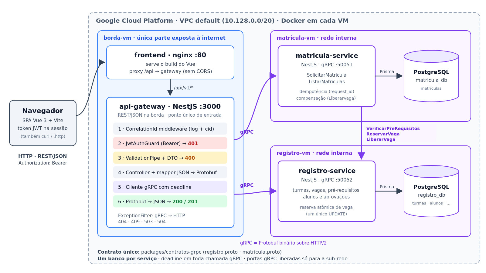

# Sistema Acadêmico Distribuído

Trabalho 2 de **Sistemas Distribuídos** (INF/UFG). Evolui o
[Trabalho 1](https://github.com/augustoCAchaves/sd-matricula-grpc), em que dois
microsserviços gRPC decidiam uma matrícula com dados em memória, para um
sistema completo: **frontend web → API Gateway REST com JWT → microsserviços
gRPC → PostgreSQL**, tudo em containers.

**Domínio:** dia de matrícula. Muitos alunos disputam as mesmas vagas ao mesmo
tempo. O aluno escolhe uma turma, e o sistema verifica pré-requisitos, reserva
a vaga de forma atômica e grava o resultado, deferido ou indeferido.



---

## 1. Arquitetura

```
 Navegador
   │  HTTP  (mesma origem, sem CORS)
   ▼
 frontend (nginx :8080) ── serve o build do Vue e faz proxy de /api ──┐
                                                                      │ REST/JSON + Authorization: Bearer
                                                                      ▼
 api-gateway (NestJS :3000)   Middleware (correlation id) → Guard JWT (401) → ValidationPipe (400)
   │                          → Controller → DTO→Protobuf → cliente gRPC com deadline → ExceptionFilter (gRPC→HTTP)
   ├──gRPC──▶ registro-service  :50052  turmas, vagas, pré-requisitos, alunos ──▶ PostgreSQL registro_db
   └──gRPC──▶ matricula-service :50051  solicitações de matrícula              ──▶ PostgreSQL matricula_db
                    │
                    └──gRPC──▶ registro-service  (VerificarPreRequisitos, ReservarVaga, LiberarVaga)
```

| Componente | Tecnologia | Porta | Responsabilidade |
|---|---|---|---|
| `apps/frontend` | Vue 3 + Vite + TS, servido por nginx | 8080 (publicada) | Telas de login, turmas (com os pré-requisitos marcados como cumpridos ou pendentes), minhas matrículas e meu histórico. Fala **só** com o gateway |
| `apps/api-gateway` | NestJS 12 (REST) | 3000 (publicada) | Ponto único de entrada: autentica (JWT), valida, traduz JSON ↔ Protobuf, orquestra e mapeia erros |
| `services/registro-service` | NestJS + gRPC + Prisma | 50052 (interna) | Turmas, vagas (reserva atômica), pré-requisitos, histórico e alunos |
| `services/matricula-service` | NestJS + gRPC + Prisma | 50051 (interna) | Decide e grava matrículas; é servidor do gateway e cliente do registro |
| `packages/contratos-grpc` | `.proto` + `@grpc/proto-loader` | — | Fonte única dos contratos e cliente gRPC compartilhado |
| `postgres-registro` / `postgres-matricula` | PostgreSQL 17 | 5432 / 5433 (só `127.0.0.1`) | **Um banco por serviço**, sem chave estrangeira entre eles |

### Jornada de uma matrícula

```
Frontend ──POST /api/v1/matriculas {codigo_turma} + JWT + Idempotency-Key──▶ Gateway
Gateway  (Guard valida o JWT → Pipe valida o corpo → aluno vem do token, não do corpo)
Gateway  ──SolicitarMatricula(aluno, turma, request_id)─────────────────────▶ matricula-service
matricula-service: request_id já visto? → devolve a mesma resposta (idempotência)
matricula-service ──VerificarPreRequisitos──▶ registro-service ──SELECT──▶ registro_db
matricula-service ──ReservarVaga───────────▶ registro-service ──UPDATE ... WHERE vagas_ocupadas < vagas_totais──▶ registro_db
matricula-service ──INSERT matricula (DEFERIDA | INDEFERIDA_*)──▶ matricula_db
                  (falhou ao gravar depois de reservar? → LiberarVaga: compensação)
Gateway  ◀── SolicitarMatriculaResponse ── matricula-service
Frontend ◀── 201 Created {protocolo, status, mensagem, pendencias} ── Gateway
```

Toda requisição recebe um **correlation id** (`x-correlation-id`), que o
gateway propaga na metadata gRPC. O mesmo id aparece nos logs dos três
componentes:

```
[gateway] --> POST /api/v1/matriculas cid=demo-readme
[gateway]     gRPC --> matricula.SolicitarMatricula cid=demo-readme
[matricula] --> SolicitarMatricula cid=demo-readme {"matricula_aluno":"2021001","codigo_turma":"SD-2026-1","request_id":"740d6979-..."}
[registro] --> VerificarPreRequisitos cid=demo-readme {"matricula_aluno":"2021001","codigo_turma":"SD-2026-1"}
[registro] <== VerificarPreRequisitos cid=demo-readme OK 8ms {"atendido":true,"disciplinas_pendentes":[]}
[registro] --> ReservarVaga cid=demo-readme {"codigo_turma":"SD-2026-1"}
[registro] <== ReservarVaga cid=demo-readme OK 8ms {"reservada":true,"vagas_disponiveis":27}
[matricula] <== SolicitarMatricula cid=demo-readme OK 34ms {"protocolo":"5bbe8151-...","status":"DEFERIDA",...}
[gateway]     gRPC <== matricula.SolicitarMatricula cid=demo-readme OK
[gateway] <== 201 POST /api/v1/matriculas cid=demo-readme 45ms
```

---

## 2. Contratos gRPC

Os arquivos ficam em [`packages/contratos-grpc/proto/`](packages/contratos-grpc/proto/).
Eles evoluem os contratos do T1 **só acrescentando** RPCs e campos, sem nunca
reaproveitar números. Um cliente do T1 continuaria funcionando. Cada acréscimo
está marcado com `// T2` no `.proto`.

| Contrato | Do T1 (inalterado) | Acrescentado no T2 |
|---|---|---|
| `registro.proto` | `ConsultarVagas`, `VerificarPreRequisitos` | `ListarTurmas`, `ReservarVaga`, `LiberarVaga`, `ConsultarAluno`; campo `pre_requisitos = 6`; depois, `aprovadas = 3` no `ConsultarAlunoResponse` (mensagem nova `Disciplina`) |
| `matricula.proto` | `SolicitarMatricula`, enum `StatusMatricula` | `ListarMatriculas`; campos `request_id = 3` (idempotência), `codigo_turma = 5`, `solicitada_em = 6` |

Os contratos são carregados **em runtime** pelo `@grpc/proto-loader`
(`keepCase`, `enums: String`, `defaults`). As interfaces TypeScript que
espelham cada mensagem estão em `packages/contratos-grpc/src/`.

---

## 3. API REST (gateway)

Base: `/api/v1`. Todas as rotas, exceto as marcadas como públicas, exigem
`Authorization: Bearer <token>`.

| Método e rota | Auth | Delegação gRPC | Sucesso | Erros |
|---|---|---|---|---|
| `POST /auth/login` | pública | `registro.ConsultarAluno` | 200 + token | 400, 401 |
| `GET /turmas` | JWT | `registro.ListarTurmas` | 200 | 401, 503/504 |
| `GET /turmas/:codigo` | JWT | `registro.ConsultarVagas` | 200 | 400, 401, 404 |
| `POST /matriculas` | JWT | `matricula.SolicitarMatricula` | **201** | 400, 401, 404, 409, 503/504 |
| `GET /matriculas` | JWT | `matricula.ListarMatriculas` (do aluno do token) | 200 | 401 |
| `GET /historico` | JWT | `registro.ConsultarAluno` (disciplinas aprovadas do aluno do token) | 200 | 401 |
| `GET /health` | pública | — | 200 | — |

- `POST /matriculas` recebe só `{"codigo_turma": "SD-2026-1"}`. **O aluno vem
  do `sub` do JWT**, e o cliente não escolhe em nome de quem age.
- O header opcional `Idempotency-Key` (UUID) vira o `request_id` do pedido.
  Repetir o pedido com a mesma chave devolve o mesmo protocolo, sem duplicar a
  matrícula nem consumir outra vaga. O frontend gera uma chave por clique e a
  reaproveita no botão "Tentar de novo".
- Uma matrícula **indeferida também é 201**: a solicitação foi criada e
  gravada, só que com o status `INDEFERIDA_*`.

**Mapeamento de erros** (`ExceptionFilter` global, como no slide 36):

| gRPC | HTTP | Exemplo |
|---|---|---|
| `INVALID_ARGUMENT` | 400 | código de turma mal formado |
| — (Guard) | 401 | sem token, token inválido ou expirado |
| `NOT_FOUND` | 404 | turma inexistente |
| `ALREADY_EXISTS` / `FAILED_PRECONDITION` / `ABORTED` | 409 | aluno já matriculado na turma |
| `UNAVAILABLE` | 503 | registro-service ou banco fora do ar |
| `DEADLINE_EXCEEDED` | 504 | serviço não respondeu no prazo |
| outros | 500 | — |

Todo erro tem o mesmo formato:

```json
{
  "status": 400,
  "erro": "BAD_REQUEST",
  "mensagem": "Dados inválidos.",
  "detalhes": ["codigo_turma é obrigatório"],
  "correlation_id": "08a4c299"
}
```

Respostas 5xx não expõem detalhes internos, como IPs, portas ou mensagens do
grpc-js. Esses detalhes ficam só no log, ligados pelo `correlation_id`.

---

## 4. Como rodar

**Pré-requisitos:** Docker com Compose v2. Para os scripts auxiliares, também
`jq` e `curl`. Para desenvolver fora do container, Node 24 e pnpm
(`corepack enable`).

```bash
cp .env.example .env
sed -i "s/^JWT_SECRET=.*/JWT_SECRET=$(openssl rand -hex 32)/" .env   # o compose recusa subir sem JWT_SECRET

docker compose up -d --build     # 2 bancos, 2 serviços gRPC, gateway e frontend
docker compose ps                # os 6 containers "Up", os bancos "(healthy)"
scripts/reset-demo.sh            # seed do registro + limpeza das matrículas
```

Abra **http://localhost:8080** e entre com a matrícula `2021001` e a senha
`sd2026`, que é o `APP_PASSWORD` do `.env`.

As migrations do Prisma rodam sozinhas quando cada serviço sobe
(`prisma migrate deploy`). O seed é separado, para poder voltar ao estado
inicial antes de cada demo.

**Frontend em modo dev** (hot reload, com o resto do sistema no compose):

```bash
pnpm install
pnpm dev:frontend                # http://localhost:5173, o Vite faz proxy de /api para localhost:3000
```

---

## 5. Dados e cenários

O seed (`services/registro-service/src/seed.ts`) recria os dados do T1 e
acrescenta uma turma quase lotada:

| Turma | Disciplina | Vagas (ocupadas/totais) | Pré-requisitos |
|---|---|---|---|
| `SD-2026-1` | Sistemas Distribuídos | 12/40 | `REDES-1`, `PROG-2` |
| `BD-2026-1` | Banco de Dados II | 30/30 (lotada) | `BD-1` |
| `REDES-2026-1` | Redes de Computadores | 20/45 | — |
| `SO-2026-1` | Sistemas Operacionais | 29/30 (última vaga) | `PROG-1` |

| Aluno | Nome | Aprovado em |
|---|---|---|
| `2021001` | Ana Souza | `REDES-1`, `PROG-1`, `PROG-2`, `BD-1` |
| `2021002` | Bruno Lima | `PROG-1`, `PROG-2` |
| `2021003` | Carla Dias | `PROG-1` |
| `2021004`–`2021013` | alunos de carga | `PROG-1` |

| Cenário | Resultado |
|---|---|
| `2021001` em `SD-2026-1` | **201 DEFERIDA**, e a vaga ocupada sobe para 13 |
| `2021001` em `SD-2026-1` de novo | **409**, aluno já matriculado |
| `2021002` em `SD-2026-1` | **201 INDEFERIDA_PRE_REQUISITO**, pendência `REDES-1` |
| `2021001` em `BD-2026-1` | **201 INDEFERIDA_SEM_VAGA** |
| Turma `XYZ-2026-1` | **404** |

---

## 6. Ferramentas de teste e demonstração

| Ferramenta | Para quê |
|---|---|
| `scripts/reset-demo.sh` | Volta os dois bancos ao estado inicial (`pnpm reset-demo`) |
| `scripts/demo-curl.sh [URL]` | Bateria de 16 passos com status esperado: 401, 401, 401, 200, 200, 400, 400, 401, 201, 201, 409, 201, 201, 404, 200 e, por fim, o registro parado (503/504). Sem URL, roda local e reseta os bancos |
| `postman/sd-sistema-academico.postman_collection.json` | A mesma bateria no Postman, mais o histórico, com testes por requisição. Roda também via Newman: `newman run postman/*.json` |
| `scripts/concorrencia.sh [URL]` | 10 alunos disputam ao mesmo tempo a **última vaga** da `SO-2026-1`: exatamente 1 DEFERIDA, 9 INDEFERIDA_SEM_VAGA, turma em 30/30 |
| `scripts/db.sh [registro\|matricula]` | Os SELECTs da demo (vagas por turma, matrículas gravadas) nos bancos que rodam naquele host |
| `scripts/grpc.sh <registro\|matricula> <Metodo> [json]` | Chama os serviços gRPC **por dentro** da rede do compose (grpcurl em container), sem passar pelo gateway |
| `pnpm db:psql:registro` / `pnpm db:psql:matricula` | `psql` dentro de cada banco |

**Ver a persistência no banco.** Use `scripts/db.sh` ou um cliente SQL. As
portas dos bancos são publicadas só em `127.0.0.1`, para inspeção: `5432` para
o `registro_db` e `5433` para o `matricula_db`, com usuário e senha do `.env`.
Exemplo:

```sql
-- registro_db: a vaga ocupada incrementou
SELECT codigo, vagas_ocupadas, vagas_totais FROM turmas ORDER BY codigo;
-- matricula_db: deferidas e indeferidas gravadas
SELECT protocolo, matricula_aluno, codigo_turma, status, pendencias, solicitada_em FROM matriculas ORDER BY solicitada_em;
```

Os dados ficam em volumes nomeados (`pgdata-registro` e `pgdata-matricula`) e
sobrevivem a `docker compose restart` e a `docker compose down`. Só
`docker compose down -v` apaga esses volumes.

---

## 7. Conceitos de Sistemas Distribuídos aplicados

- **REST na borda, gRPC por dentro.** O navegador fala JSON legível. Entre os
  serviços, o contrato é tipado (`.proto`), a serialização é binária e a
  conexão HTTP/2 é persistente.
- **Banco por serviço.** `registro_db` e `matricula_db` são instâncias
  separadas. O `matricula-service` nunca lê as tabelas do registro, e pergunta
  via gRPC. Não existe FK entre os bancos, e a consistência entre eles é
  responsabilidade da aplicação.
- **Concorrência e reserva atômica.** A vaga é reservada com um único
  `UPDATE turmas SET vagas_ocupadas = vagas_ocupadas + 1 WHERE codigo = $1 AND vagas_ocupadas < vagas_totais RETURNING ...`.
  Ler, checar e depois escrever criaria uma condição de corrida pela última
  vaga. Um `CHECK` no banco garante `vagas_ocupadas <= vagas_totais`.
- **Idempotência.** O `request_id` é `UNIQUE` em `matricula_db`. Repetir o
  pedido, seja por clique duplo, retry ou timeout no meio do caminho, devolve
  a resposta original. Um índice único parcial (`WHERE status = 'DEFERIDA'`)
  garante no máximo uma matrícula deferida por aluno e turma, mesmo com pedidos
  simultâneos.
- **Compensação (falha parcial).** Se a vaga foi reservada no registro, mas a
  gravação da matrícula falhar, o `matricula-service` chama `LiberarVaga`. É
  uma transação distribuída simplificada, no estilo saga.
- **Deadline em toda chamada.** São 2 s de matrícula para registro e 8 s do
  gateway para os serviços. Um serviço lento ou parado vira **503/504** em
  segundos, em vez de travar o gateway. O nginx do frontend também tem prazo
  de conexão (3 s) com o gateway.
- **Rastreamento.** O correlation id é gerado no gateway (ou aceito do
  cliente) e propagado na metadata gRPC até o último serviço.
- **Configuração por ambiente.** Nenhum endereço é fixo no código. No compose,
  os serviços se acham pelo nome (`registro-service:50052`). Em VMs, usam o IP
  interno da outra VM.

---

## 8. Configuração

Todas as variáveis vêm do `.env`, que o compose lê da raiz. O arquivo
`.env.example` é o modelo versionado.

| Variável | Default | Uso |
|---|---|---|
| `POSTGRES_USER` / `POSTGRES_PASSWORD` | `academico` | Credenciais dos dois bancos |
| `JWT_SECRET` | **obrigatória** | Segredo HS256 do gateway. Sem ela, o compose não sobe |
| `APP_PASSWORD` | `sd2026` | Senha única de laboratório para o login |
| `REGISTRO_GRPC_URL` | `registro-service:50052` | Onde o gateway e o matricula-service acham o registro |
| `MATRICULA_GRPC_URL` | `matricula-service:50051` | Onde o gateway acha o matricula-service |
| `GATEWAY_HOST` | `api-gateway:3000` | Para onde o nginx do frontend encaminha `/api` |

Dentro dos containers também existem `GRPC_DEADLINE_MS` (gateway, 8000),
`REGISTRO_DEADLINE_MS` (matrícula, 2000) e `JWT_EXPIRES_IN` (gateway, 3600 s).

---

## 9. Deploy no Google Cloud

Cada componente roda na sua própria VM (`e2-medium`, Debian 12, zona
`us-central1-a`). Os containers e as imagens são os mesmos do compose local.
Só muda quais serviços cada VM sobe e quais portas ela publica.

| VM | IP interno | Containers | Entrada permitida (firewall) |
|---|---|---|---|
| `borda-vm` | `10.128.0.10` | `api-gateway` + `frontend` | tcp:80 e tcp:3000 da internet (`t2-borda-web`) |
| `registro-vm` | `10.128.0.11` | `postgres-registro` + `registro-service` | tcp:50052 só da sub-rede `10.128.0.0/20` (`t2-grpc-interno`) |
| `matricula-vm` | `10.128.0.12` | `postgres-matricula` + `matricula-service` | tcp:50051 só da sub-rede `10.128.0.0/20` (`t2-grpc-interno`) |

```
 navegador ──HTTP :80──▶ borda-vm (IP externo fixo)
                           nginx ──/api──▶ api-gateway
                                            ├──gRPC 10.128.0.11:50052──▶ registro-vm  ─▶ registro_db
                                            └──gRPC 10.128.0.12:50051──▶ matricula-vm ─▶ matricula_db
                                                                            └──gRPC 10.128.0.11:50052──▶ registro-vm
```

- **IP interno vs. externo.** VM ↔ VM usa o IP interno, fixado na criação
  (`--private-network-ip`). Por isso o `.env` já nasce com os endereços certos.
  O navegador usa o IP externo da `borda-vm`, que é **reservado**
  (`t2-borda-ip`) e não muda com stop/start.
- **Um `.env` para as três VMs** (`.env.gcp`, gerado pelo script e fora do
  git). Ele traz `COMPOSE_FILE=docker-compose.yml:docker-compose.gcp.yml`,
  então todo `docker compose` na VM já aplica o override
  [`docker-compose.gcp.yml`](docker-compose.gcp.yml). O override publica as
  portas gRPC, que as outras VMs precisam alcançar, e troca o frontend de
  `8080` para `80`.
- **As portas gRPC não são alcançáveis da internet.** As VMs de serviço têm IP
  externo só para baixar o Docker e clonar o repositório.
- O `restart: unless-stopped` mantém os containers vivos depois de fechar o
  SSH e de um reboot da VM.

### Passo a passo

Pré-requisito: `gcloud auth login` e o projeto configurado (`gcloud config set project <ID>`).

```bash
scripts/gcp.sh criar     # firewall, IP externo fixo e as 3 VMs; o startup script instala Docker e clona o repo
scripts/gcp.sh subir     # gera o .env.gcp, envia para cada VM e roda `docker compose up -d --build` (registro → matrícula → borda)
scripts/gcp.sh reset     # seed do registro_db e limpeza do matricula_db
scripts/gcp.sh status    # containers de cada VM + URL pública
```

Depois disso, a mesma bateria local roda contra a nuvem:

```bash
scripts/demo-curl.sh http://<IP-EXTERNO>          # 15 passos, sem o 503
scripts/concorrencia.sh http://<IP-EXTERNO>       # 1 DEFERIDA, 9 SEM_VAGA entre VMs
newman run postman/*.json --env-var baseUrl=http://<IP-EXTERNO>/api/v1
```

| Comando | Para quê |
|---|---|
| `scripts/gcp.sh logs <borda\|registro\|matricula>` | Acompanha o log do serviço daquela VM (um terminal por VM na demo) |
| `scripts/gcp.sh db` | Os SELECTs da demo, cada um na VM do seu banco |
| `scripts/gcp.sh ssh registro 'sudo docker compose stop registro-service'` | Derruba o registro para mostrar o **503** (`start` para religar; volta em ~5 s) |
| `scripts/gcp.sh subir borda` | Redeploy de uma VM só (faz `git pull` e rebuild) |
| `scripts/gcp.sh desligar` / `ligar` | Para as VMs e o custo de CPU; os dados ficam nos volumes |

> **Use a porta 80 também para o Postman e o curl.** O nginx encaminha `/api`
> ao gateway, então `http://<IP-EXTERNO>/api/v1` é o mesmo gateway da porta
> 3000. Redes institucionais, como a da UFG, bloqueiam a saída para portas
> não padrão. A 3000 funciona de outras redes, mas dá timeout de dentro do
> campus.

**Plano B:** numa única VM, `docker compose up -d --build` sem o override
roda o sistema ponta a ponta (frontend na 8080).

---

## 10. Erros comuns

| Sintoma | Causa | Ação |
|---|---|---|
| `defina JWT_SECRET no .env` ao subir | `.env` ausente ou sem segredo | `cp .env.example .env` e gere um `JWT_SECRET` (seção 4) |
| `port is already allocated` (3000, 8080, 5432, 5433) | Container ou processo antigo segurando a porta | `docker ps` e `ss -ltnp \| grep :3000` |
| Login correto devolve 401 | Banco sem seed, então o aluno não existe | `scripts/reset-demo.sh` |
| Todos os tokens viraram 401 | `JWT_SECRET` mudou e o gateway foi recriado | Entre de novo |
| Registro parado devolve **504**, e não 503 | No compose local, o container parado sai do DNS do Docker e a chamada espera a deadline. Em VMs, a porta fechada recusa a conexão: 503 | Esperado. Os dois códigos significam "serviço interno fora do ar, sem travar" |
| Frontend mostra "Falha HTTP 502/504 antes de chegar ao gateway" | O nginx não alcançou o gateway | `docker compose ps api-gateway` e `docker compose logs api-gateway` |
| Primeiras chamadas logo após `start` dão 503 | O serviço ainda está aplicando as migrations | Aguarde alguns segundos. O canal gRPC reconecta sozinho |
| Timeout no `IP:3000` a partir da UFG, mas a porta 80 funciona | A rede local bloqueia a saída para a porta 3000. O firewall do GCP está certo (de dentro do GCP, a 3000 responde) | Use `http://IP/api/v1`, pelo nginx |
| Funciona local, falha entre VMs | `.env` com nome do compose em vez do IP interno, ou firewall | Teste: `timeout 5 bash -c "cat < /dev/null > /dev/tcp/<IP>/<PORTA>"; echo $?` (0 = aberta, 124 = bloqueada) |

---

## 11. Decisões técnicas

- **TypeScript em todo o projeto (NestJS + Vue)** no lugar do Java do T1. O
  `.proto` é o contrato, e por isso os serviços podem trocar de linguagem sem
  que o outro lado mude: é o papel do middleware de mascarar a
  heterogeneidade.
- **NestJS no gateway**, porque cada requisito tem uma peça pronta: `Guard`
  (401), `ValidationPipe` com `class-validator` (400), `ExceptionFilter`
  (gRPC → HTTP) e middleware (correlation id). A ordem do Nest é Middleware →
  Guard → Pipe → Controller, então **autenticação vem antes da validação**:
  o mesmo corpo inválido devolve 401 sem token e 400 com token.
- **`@grpc/proto-loader` em runtime** em vez de geração de código. Não há
  passo de codegen no build, e as interfaces TS escritas à mão espelham o
  `.proto`.
- **Um canal gRPC por destino, reutilizado.** O canal re-resolve o DNS a cada
  2 s, para reconectar rápido quando um container volta com outro IP.
- **Prisma 7** com `@prisma/adapter-pg`, para schema, migrations e client
  tipado. As regras que o Prisma não expressa ficam em SQL na migration: o
  `CHECK` de vagas e o índice único parcial.
- **Login de laboratório**, como na referência do professor: o usuário é a
  matrícula de um aluno do seed e a senha é única (`APP_PASSWORD`). O token
  HS256 leva `sub` = matrícula e expira em 1 h.
- **Frontend servido por nginx com proxy de `/api`.** O navegador só conhece
  uma origem, então não há CORS e a URL do gateway não fica embutida no build
  do Vite. O `resolver` do nginx re-resolve o nome do gateway, e um gateway
  recriado não quebra o proxy.
- **Docker em todos os componentes**, com o build context na raiz do monorepo,
  imagens `node:24-slim` (o Prisma precisa de OpenSSL/glibc) e
  `nginx:1.30-alpine` para o frontend. Só o gateway e o frontend publicam
  porta; as portas gRPC ficam na rede interna.
- **Sem TLS** entre os serviços nem na borda, por simplicidade didática, como
  nas aulas. Em produção seriam HTTPS na borda e mTLS entre os serviços.

### Limitações conhecidas / próximos passos

- Login sem tabela de usuários: o próximo passo é guardar o hash de senha no
  `registro_db` e criar o RPC `AutenticarAluno`.
- A compensação é síncrona e best-effort. Se o próprio `LiberarVaga` falhar, a
  vaga fica presa até uma correção manual, e isso é registrado no log. Uma
  fila de mensagens resolveria essa limitação, assim como a lista de espera
  num pico de pedidos, e é candidata à 3ª entrega.

---

## Estrutura

```
packages/contratos-grpc/     # .proto (fonte única dos contratos) + cliente gRPC compartilhado
services/registro-service/   # turmas, vagas, pré-requisitos, alunos (Prisma → registro_db)
services/matricula-service/  # solicitação e registro de matrículas (Prisma → matricula_db)
apps/api-gateway/            # REST: JWT, validação, tradução JSON ↔ Protobuf, erros gRPC → HTTP
apps/frontend/               # Vue 3 + Vite, servido por nginx com proxy de /api
scripts/                     # reset da demo, bateria curl, concorrência, consultas ao banco, grpcurl
postman/                     # coleção da bateria da demo
docs/                        # imagem da arquitetura
docker-compose.yml           # sobe tudo localmente
```

**Autores:** Augusto César Arantes Chaves e Bruno Bezerra Carvalho.
